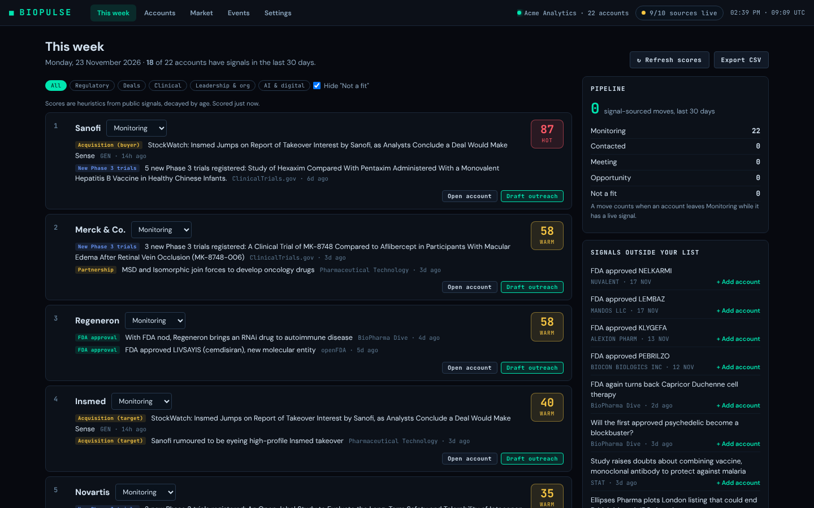

# BioPulse

**Know which accounts to call this week, and why.** BioPulse is a free account-signal tool for sellers at life sciences data, AI and IT services firms. It reads FDA, ClinicalTrials.gov and 8 trade feeds for each of your pharma and biotech accounts. It scores what changed and drafts a sourced first message.



Product requirements: [docs/PRD.md](docs/PRD.md) (living version linked inside).

## What it does

| Screen | What you get |
|---|---|
| **This week** | Your accounts ranked by a 0 to 100 signal score, the top triggers for each with source links, "new since last visit" badges, filters by signal family, a pipeline count, strong signals from companies not on your list, and events coming up |
| **Account panel** | Why the score is what it is (every signal and its points), thumbs up or down per signal, a one-click outreach draft (email, LinkedIn note, call opener) grounded in one trigger, a pre-call brief from the live trial portfolio and 24 months of FDA history, matching settings and stage history |
| **Accounts** | Add one, paste a list, or start from packs (large pharma, obesity and cardiometabolic, cell and gene therapy, CROs). Stage per account: Monitoring, Contacted, Meeting, Opportunity, Not a fit. CSV export |
| **Market** | Recruiting trials by country, new trials by therapy area, novel FDA approvals, deal radar, the full news feed (with a "My accounts" filter) and biotech quotes |
| **Events** | 12 major 2027 life sciences conferences with checked dates, and an AI go, watch or skip fit score against your firm profile |
| **Weekly digest** | A Monday email (about 07:00 IST) listing accounts with new signals since the last one. One-click unsubscribe, no tracking |

**Signals.** 14 trigger types, each with a weight and a reason it matters to a services buyer: leadership change, acquisition (buyer or target), FDA approval, FDA rejection, financing, AI initiative, pivotal readout, new Phase 3 trials, trial surge, restructuring, safety action, partnership and Phase 2 readout. Plain news mentions count as context only. Scores decay by half every 14 days. Registry signals compare each sponsor with its own previous 90 days, so routine activity at big companies is not mistaken for a surge. The full model is in the PRD.

**Honest by default.** No placeholder data. Every signal links to its source. Every panel says when a source is down and shows the last good copy with its age. AI text is labelled as AI. Scores are labelled as heuristics.

## How it works

```
Browser (static site, ES modules, no build step)
   │  fetch /api/*
   ▼
Netlify Functions
   ├─ /api/workspace   create, read, save, delete a private workspace (no passwords)
   ├─ /api/signals     score up to 10 accounts per call: news + openFDA + ClinicalTrials.gov
   ├─ /api/ai          Groq, server-side key, fixed prompt templates (outreach, brief, event fit)
   ├─ /api/digest      send a test digest now (Resend)
   ├─ /api/unsubscribe one-click digest opt-out
   ├─ digest-weekly    scheduled: Mondays, hourly 01:30 to 06:30 UTC
   └─ /api/news · trials · fda · quotes · company · health
Netlify Blobs: workspaces, cached source data (last good copy), rate limits, AI answer cache
```

**Workspaces** are identified by a random 128-bit ID that lives in the URL hash (`#/week?w=…`). Anyone with the link can open the workspace, so treat it like a password. The ID never appears in a query string or a `Referer` header.

**AI** uses Groq `openai/gpt-oss-120b`, with `openai/gpt-oss-20b` as a fallback. The browser sends only task inputs, never prompts. Requests are limited to 40 per IP per hour and 800 per day site-wide.

## Deploy

See **Owner actions** in [docs/PRD.md](docs/PRD.md#owner-actions) for the step-by-step version. In short:

1. Netlify → Add new site → Import from GitHub → this repo, branch `main`. Leave the build command empty and set the publish directory to `.`.
2. Site configuration → Environment variables:

| Variable | Required | Purpose |
|---|---|---|
| `GROQ_API_KEY` | yes, for AI | Groq key (`gsk_...`) |
| `RESEND_API_KEY` | yes, for the digest | Resend key (`re_...`) |
| `DIGEST_FROM` | no | Sender, e.g. `BioPulse <digest@yourdomain.com>`. Default `BioPulse <onboarding@resend.dev>` delivers only to the Resend account owner's address |
| `OPENFDA_API_KEY` | recommended | Raises openFDA's 1,000 calls/day limit; free at open.fda.gov |
| `PUBLIC_APP_URL` | no | Base URL used in email links (defaults to the Netlify site URL) |
| `GROQ_MODEL`, `GROQ_FALLBACK_MODEL` | no | Override the models |
| `AI_HOURLY_LIMIT_PER_IP`, `AI_DAILY_LIMIT` | no | Defaults 40 and 800 |
| `ALLOWED_ORIGINS` | no | Extra origins allowed to call the write APIs (GitHub Pages is allowed by default) |

3. Trigger a deploy, then open `/api/health`. It should show AI and email as configured.
4. Optional: to keep GitHub Pages working, set `apiBase` in `assets/config.js` to the Netlify URL.

## Run locally

```bash
npm install
GROQ_API_KEY=gsk_... RESEND_API_KEY=re_... node scripts/dev-server.mjs   # http://localhost:8888
```

## Tests

```bash
npm test                        # 59 unit tests: scoring model, matching, classification, workspaces, digest, every endpoint
python3 tests/e2e/test_ui.py    # 74 browser checks: onboarding, ranking, outreach, stages, demo, failures, GitHub Pages mode,
                                #   XSS, mobile and tablet layouts, labels
node tests/live-smoke.mjs       # real sources: feeds, ClinicalTrials.gov, openFDA, quotes, workspace + live scoring
```

## Limits
- Scores are heuristics and should be read as "worth a look", not as a forecast.
- News signals depend on an account being named in a headline; set aliases and the registry name for best matching.
- Deal values come only from headlines that state a dollar figure.
- openFDA can lag FDA announcements by a few days.
- Fierce Pharma, Fierce Biotech and Endpoints block server-side feed readers and are not included.
- Conference dates in `data/conferences.json` were checked on 23 Nov 2026. Update the file yearly.
